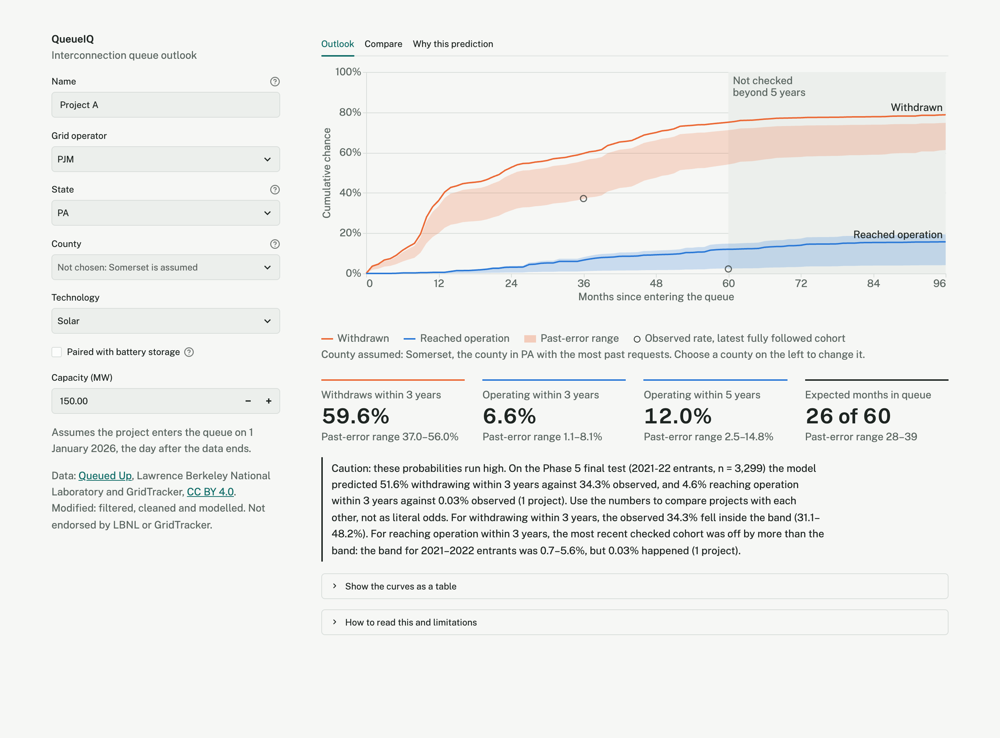
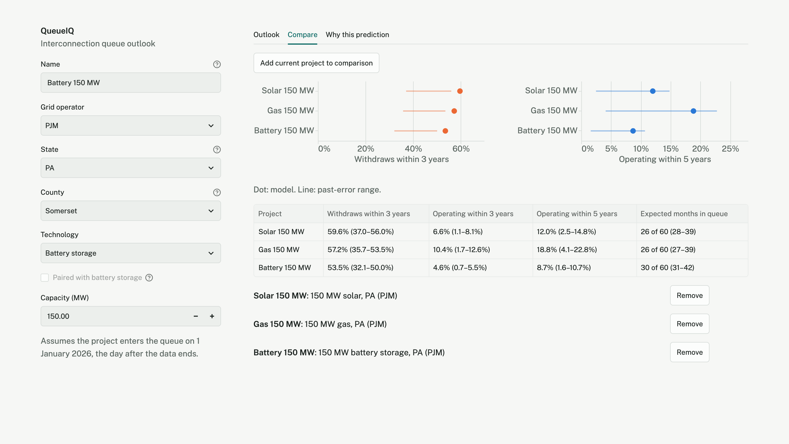
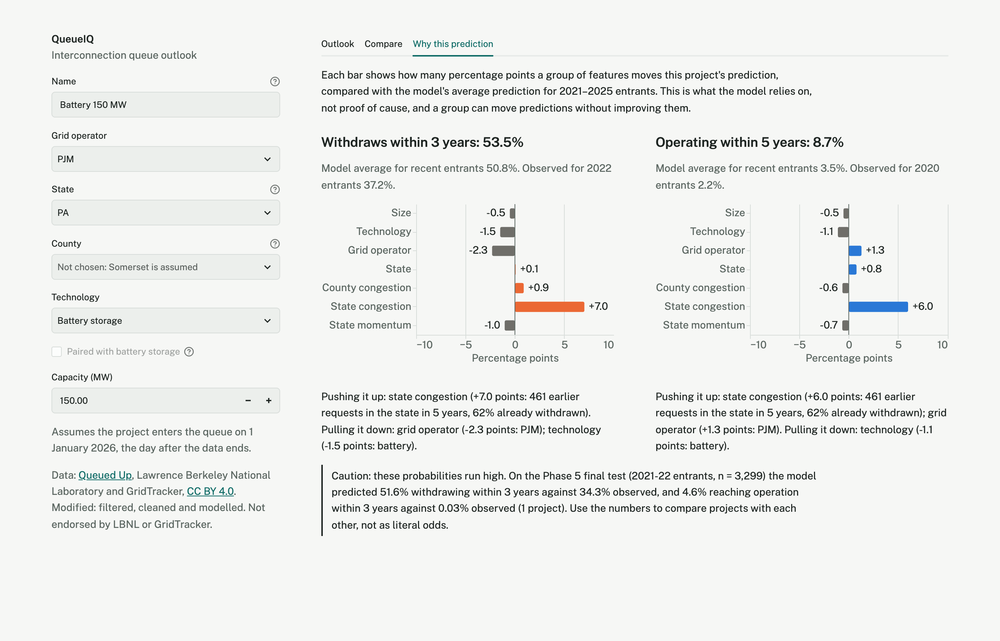
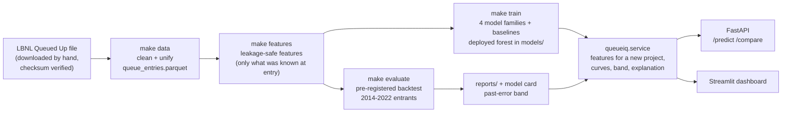

# QueueIQ

When a solar farm, wind farm, battery or gas plant asks to connect to the US power grid, it joins an
interconnection queue. Most projects never get built. QueueIQ estimates, for a proposed project on the day it
joins the queue, the chance that it **withdraws** or **reaches commercial operation**, month by month. It treats
the two outcomes as competing risks, so projects still waiting are not thrown away or mislabelled.

It is trained on Lawrence Berkeley National Laboratory's *Queued Up* data: 14,796 projects that entered the PJM,
MISO, CAISO and SPP queues from 2010 to 2025. By the end of 2025, 9,627 of them had withdrawn, 1,230 were
operating and 3,939 were still waiting. It ships as a small API and a dashboard for comparing project setups.

**The short version of the results:** the model can tell which projects are more likely to get built, but it
does little better than chance at telling which will withdraw. Its probabilities also run too high on recent
projects. The project's value is in the method (leakage-safe features, a pre-registered time-based
evaluation, honest uncertainty), not in a strong predictor. The write-up tells the whole story in plain
language: [reports/writeup.md](reports/writeup.md).

## What I found

All numbers come from code in this repository. They were tested on entry years the model never saw, with
outcomes known at least 3 years out. Ranges in brackets are 95% bootstrap intervals.

- **Reaching operation: the ranking holds up where it can be checked.** On 2014–2017 entrants, the 3-year AUC
  was 0.723 [0.689, 0.760]. Across the seven test years from 2014 to 2020 it ranged from 0.693 to 0.888.
  Size and technology do most of the work: gas projects are built far more often than batteries.
- **It can't be checked on the newest projects.** Only 1 of the 3,299 projects that entered in 2021–22 reached
  operation within 3 years, so ranking for that cohort can't be measured at all.
- **Withdrawal: close to chance.** On the final test (2021–22 entrants), the withdrawal AUC was 0.559
  [0.539, 0.579]. Across the seven earlier test years it ranged from 0.474 to 0.601. Withdrawals seem to be
  driven by things the data doesn't contain, such as financing, contracts and grid-upgrade costs.
- **Probabilities run high.** For 2021–22 entrants the model predicted 51.6% would withdraw within 3 years,
  and 34.3% did. It predicted 4.6% would be operating, and 0.03% were. It over-predicted withdrawal in every
  test year. Missing withdrawal dates in the data explain at most 3% of that gap.
- **The pre-registered model choice did not carry over.** The selection was frozen on 2014–2017 data before the
  final test was run once. On that test, 12 of the 14 other candidates had higher withdrawal skill than the
  selected forest (best: a Cox model with entry year and recalibration, 0.216 vs 0.041). The choice was not
  switched afterwards, because that would mean tuning on the test set.
- **The queue-congestion features did not help withdrawal.** For the random survival forest, the version
  without them scored higher withdrawal skill in development (0.051 vs 0.034) and on the final test (0.167 vs
  0.127). Results for the other model families were mixed.
- **The uncertainty band is honest about its own miss.** The dashboard's band covered the 2021–22 withdrawal
  rate (band 31.1–48.2%, observed 34.3%), but not the operation rate (band 0.7–5.6%, observed 0.03%), and the
  dashboard says so.

Details: [evaluation report](reports/evaluation.md), [model card](docs/model_card.md),
[explanations](reports/explanations.md), [decision log](docs/decisions.md).

## The dashboard and API

| Outlook | Compare | Why this prediction |
|---|---|---|
|  |  |  |

Phone width: [outlook](docs/screenshots/outlook_phone.png), [compare](docs/screenshots/compare_phone.png),
[why](docs/screenshots/why_phone.png), [input error](docs/screenshots/error_phone.png).

**How to read it.** For a project entering the queue on 1 January 2026, the lines show the deployed model's
chance of having withdrawn, or reached operation, by each month. The shaded band is the **past-error range**:
the same curves redrawn with each of the model's 2014–2020 calibration errors (decision D-046). It is not a
confidence interval. Fewer projects withdrew than predicted in every past test year, so the band sits below
the withdrawal line. Curves beyond 60 months were never checked against real outcomes (greyed out). If you
don't choose a county, the busiest county in the state is assumed and named on screen.

### Run it

Needs the LBNL data file (see [Getting the data](#getting-the-data)), [uv](https://docs.astral.sh/uv/), `make`
and Docker with about 3 GB of memory for containers (4 GB is comfortable).

```bash
make setup                 # pinned dependencies
make data && make train    # processed data + the deployed model in models/ (under a minute)
docker compose up          # dashboard: http://localhost:8501   API: http://localhost:8000/docs
```

The first `docker compose up` builds the image. That takes about 6 minutes on an Apple-silicon laptop,
mostly compiling one scientific dependency. The image holds code only: `models/` and `data/processed/` are
mounted read-only, so the model is never baked into the image or committed. Without Docker, run `make app`
(dashboard) and `make api` (API) instead.

```bash
curl -s -X POST localhost:8000/predict -H 'content-type: application/json' \
  -d '{"iso": "MISO", "state": "IL", "fuel": "wind", "capacity_mw": 200}'
```

`GET /options` lists valid states, counties and the capacity range. `POST /predict?explain=true` adds the
explanation. `POST /compare` takes up to 5 projects.

## How it fits together



- **Features** for a new project come from the same code that built the training features. A test re-enters
  1,486 real projects through the service and gets exactly their training features back.
- **Models:** an Aalen-Johansen baseline by region and fuel, cause-specific Cox, cause-specific random survival
  forests and a discrete-time LightGBM model. All were scored on the same time-based splits. The deployed model
  is the forest chosen by the pre-registered rule, refit on all data through 2025.
- **Evaluation** followed a protocol committed before any result was computed (git tag `eval-protocol-v1`).
  Models were developed on 2014–2017 entrants, 2018–2020 were reported only, and 2021–22 was a final test run
  once.

## Limitations

- **Withdrawal is barely predictable from entry-day information.** Use the withdrawal numbers to compare
  setups with each other, not as odds.
- **The probability levels drift.** New requests in these four regions rose from 631 in 2015 to 1,720 in 2021,
  and the rules changed (for example FERC Order 2023). The model, trained mostly on earlier years,
  over-predicts both outcomes for recent entrants.
- **How well the deployed model does is unknown.** It is fit on every project through 2025, so no later cohort
  exists to check it against. That needs 3 to 5 more years of outcomes. The evidence behind it is the backtest
  of the same procedure on earlier years.
- **Horizons are capped.** Results were checked at 3 and 5 years only. The curves out to 8 years are unchecked.
- **Scope:** 4 of the 9 regions in LBNL's data, entry years 2010 on. The other regions lack usable event dates.
- **Missing drivers:** nothing about financing, power purchase agreements, study results or upgrade-cost
  allocations, which is where most withdrawals are decided.
- **Associations only.** Nothing here says what *causes* a project to withdraw or get built.

## Next steps

1. **Re-test when the next LBNL edition arrives.** It will show 2023 entrants at 3 years: the first check of
   the deployed model itself, and of the past-error band.
2. **A second, pre-registered protocol (v2)** that names the better final-test variant (Cox with entry year and
   recalibration) in advance and tests it only on cohorts that don't exist yet. Adopting it after seeing the
   final test would be tuning on the test set.
3. **Features closer to where withdrawals happen,** where they are known at entry: point-of-interconnection and
   substation congestion from the operators' own queue exports, and links to EIA-860 plant data.
4. **Recalibrate by era** instead of one global model, so probability levels follow the current queue.

## Reproduce the full pipeline

Requires [uv](https://docs.astral.sh/uv/) and `make`. uv installs the pinned Python version (3.12) itself.
On macOS, LightGBM also needs the OpenMP runtime: `brew install libomp`.

```bash
make setup         # install pinned dependencies + git hooks
make data          # verify the raw LBNL file and build the processed dataset
make eda           # exploratory analysis: reports/eda.md + figures
make features      # leakage-safe feature table + reports/features.md
make train         # all models on one time split + reports/model_comparison.md + the deployed model
make evaluate-dev  # development backtest + frozen model selection
make evaluate      # extension + final test (run once) + evaluation report + model card
make explain       # reports/explanations.md (grouped Shapley values, permutation importance)
make error-range   # past-error band for the dashboard (from saved evaluation results)
make check         # lint + tests
make help          # list all targets
```

`make evaluate` re-runs the final test, which the protocol allows only once. Use `make evaluate-render` to
rebuild the report from saved results.

### Getting the data
The LBNL data file needs a free registration, so a script can't download it.
1. Go to https://emp.lbl.gov/queues and download the **Queued Up 2026 Data File (XLSX)**.
2. Save it unchanged as `data/raw/LBNL_Ix_Queue_Data_File_thru2025.xlsx`.
3. Run `make data`. It checks the file's SHA-256 against [docs/data_sources.md](docs/data_sources.md), then
   writes `data/processed/queue_entries.parquet` and [reports/data_quality.md](reports/data_quality.md).

## Data and license

**Data.** *Queued Up Data File. Copyright (c) 2026, The Regents of the University of California, through
Lawrence Berkeley National Laboratory & GridTracker.* Licensed under
[CC BY 4.0](https://creativecommons.org/licenses/by/4.0/). Source: https://emp.lbl.gov/queues.
**Changes made:** the data was filtered to PJM, MISO, CAISO and SPP projects entering from 2010, cleaned and
unified (see [docs/decisions.md](docs/decisions.md)), and used to derive features and fit models. The data
file itself is not redistributed here. LBNL and GridTracker do not endorse this project.

**Code.** MIT License, see [LICENSE](LICENSE). The MIT license covers the code only, not the LBNL data.

## Docs
- [reports/writeup.md](reports/writeup.md): the project in plain language
- [docs/decisions.md](docs/decisions.md): every design decision and why it was made
- [docs/evaluation_protocol.md](docs/evaluation_protocol.md): the pre-registered evaluation protocol
- [reports/evaluation.md](reports/evaluation.md): backtest, final test, bootstrap intervals, calibration
- [docs/model_card.md](docs/model_card.md): intended use, performance, limitations
- [reports/explanations.md](reports/explanations.md): what the model relies on
- [docs/data_sources.md](docs/data_sources.md): provenance, license, checksum
- [docs/data_dictionary.md](docs/data_dictionary.md): column definitions
- [reports/data_quality.md](reports/data_quality.md), [reports/eda.md](reports/eda.md),
  [reports/features.md](reports/features.md), [reports/model_comparison.md](reports/model_comparison.md)
