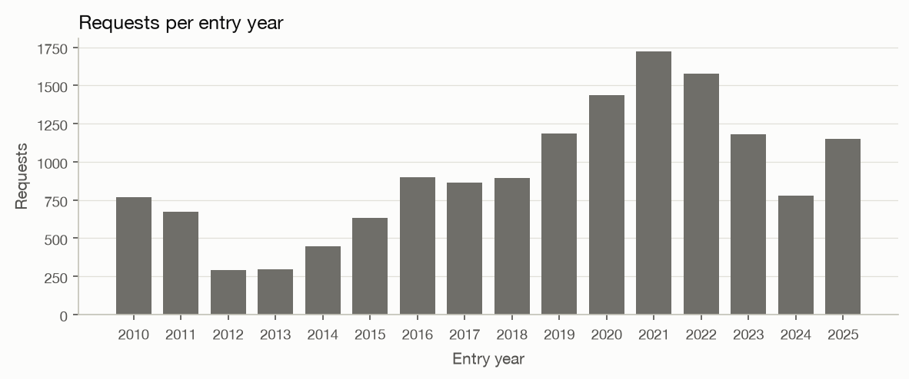
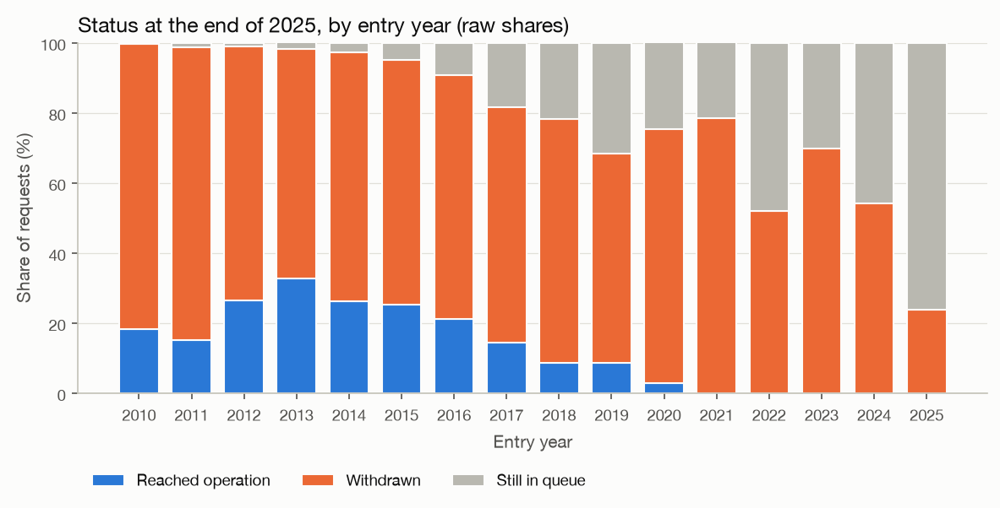
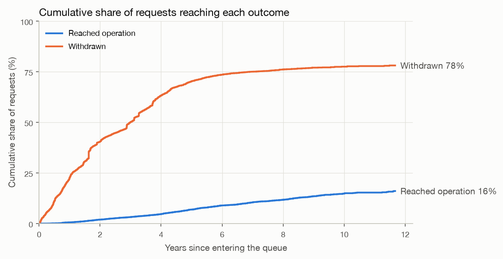
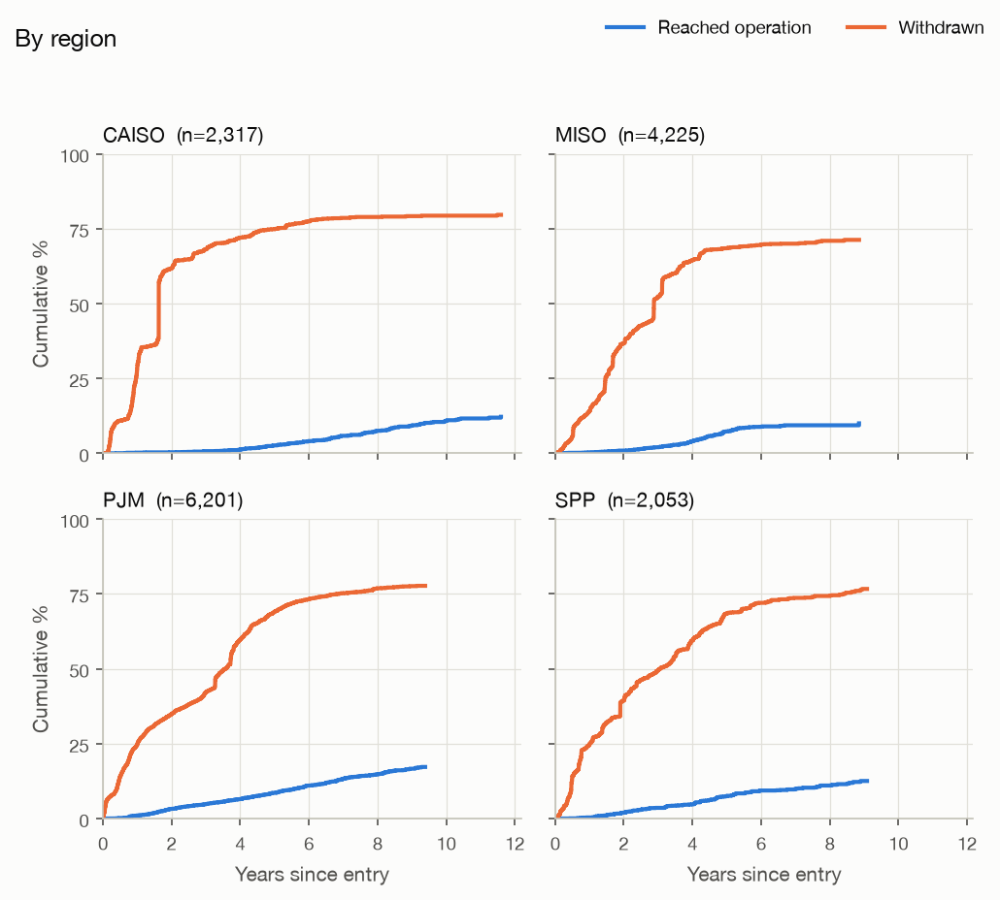
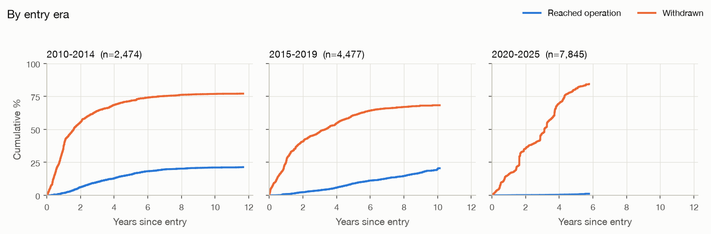
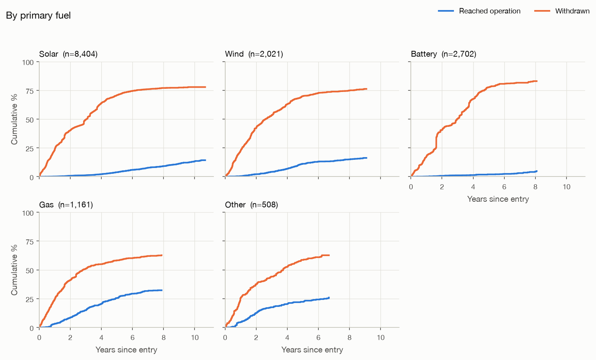

# Exploratory analysis (generated by `make eda`, do not edit by hand)

Data: LBNL Queued Up 2026 edition, cutoff 2025-12-31. Unless a section says
otherwise, the numbers cover the **model scope**: 14,796 new-generation requests in
PJM, MISO, CAISO, SPP that entered in 2010–2025
(see `reports/data_quality.md` for how that scope was chosen).

Outcomes in scope: 9,627 withdrawn,
1,230 reached operation,
3,939 still in the queue
(censored).

## Key findings

1. **Reaching operation is rare and slow.** A censoring-aware estimate says
   3.2% of requests reached operation within 3 years of entering the
   queue
   and 6.9% within 5 years. By then 70.3% had
   withdrawn.
2. **Recent cohorts are mostly unresolved.** From 2022 on, between 30.1% and
   76.2% of each year's requests are still in the queue. Their outcomes are
   mostly unknown, so raw "% operational" for recent years means little. This is why the models
   must handle censoring.
3. **Outcomes have shifted over time.** Within 5 years, the share reaching operation was
   15.7% for 2010–2014 entries and 0.7%
   for 2020–2025 entries (the latter based on 419 projects still observed at
   5 years). Withdrawal within 5 years went from 71.5% to
   80.9%. Only 41 requests from 2020–2025 have reached
   operation so far.
4. **Fuel type matters a lot.** Share reaching operation within 5 years: gas 25.5%,
   wind 11.2%, solar 3.9%, battery 2.0%. These are
   raw group comparisons, not effects: the fuel mix also changes across eras and regions (for
   example, 76.7% of battery requests entered in 2020 or later, against
   27.0% of gas). Phase 4 models estimate these factors jointly.
5. **Our reading of the file matches LBNL's published figures** (see the cross-check below).

### What this means for modelling (Phases 3–5)
- Operation is the rare event. Test sets drawn from recent cohorts will contain very few
  operational events, so metrics for that event will be noisy. Report confidence intervals and
  per-cohort numbers.
- The change over time means a model trained on older cohorts may not transfer to newer ones.
  The rolling-origin backtest (train on the past, test on the next year) measures exactly that.
- Entry year (or era) and fuel type are strong candidate features.

## Requests per entry year

## Status by entry year (raw, not censoring-aware)
Shares of each entry year's requests by status at the end of 2025. Recent years look as if
"nobody gets built", mostly because they haven't had time yet. `min/max_followup_years` is the
range of time each cohort has been observed.

| entry_year | requests | operational | withdrawn | in_queue | max_followup_years | min_followup_years |
|---|---|---|---|---|---|---|
| 2010 | 767 | 18.3 | 81.4 | 0.4 | 16.0 | 15.0 |
| 2011 | 672 | 15.2 | 83.6 | 1.2 | 15.0 | 14.0 |
| 2012 | 291 | 26.5 | 72.5 | 1.0 | 14.0 | 13.0 |
| 2013 | 297 | 32.7 | 65.7 | 1.7 | 13.0 | 12.0 |
| 2014 | 447 | 26.2 | 71.1 | 2.7 | 12.0 | 11.0 |
| 2015 | 631 | 25.2 | 69.9 | 4.9 | 11.0 | 10.0 |
| 2016 | 901 | 21.2 | 69.6 | 9.2 | 10.0 | 9.0 |
| 2017 | 864 | 14.4 | 67.2 | 18.4 | 9.0 | 8.0 |
| 2018 | 896 | 8.8 | 69.5 | 21.7 | 8.0 | 7.0 |
| 2019 | 1185 | 8.7 | 59.8 | 31.5 | 7.0 | 6.0 |
| 2020 | 1437 | 2.8 | 72.7 | 24.6 | 6.0 | 5.0 |
| 2021 | 1720 | 0.1 | 78.5 | 21.5 | 5.0 | 4.0 |
| 2022 | 1579 | 0.0 | 52.0 | 48.0 | 4.0 | 3.0 |
| 2023 | 1180 | 0.0 | 69.9 | 30.1 | 3.0 | 2.0 |
| 2024 | 777 | 0.0 | 54.3 | 45.7 | 2.0 | 1.0 |
| 2025 | 1152 | 0.0 | 23.8 | 76.2 | 1.0 | 0.0 |

## Censoring-aware outcome curves (Aalen-Johansen)
These estimate the cumulative share of requests reaching operation or withdrawing within *t*
years, using each project only for as long as it was observed. Curves stop once fewer than
30 projects are still observed. Estimates at 3 and 5 years are blank under the
same rule.

| scope | requests | at_risk_3y | operational_by_3y_% | withdrawn_by_3y_% | at_risk_5y | operational_by_5y_% | withdrawn_by_5y_% |
|---|---|---|---|---|---|---|---|
| All | 14796 | 5843 | 3.2 | 50.2 | 2095 | 6.9 | 70.3 |

### By region

| iso | requests | at_risk_3y | operational_by_3y_% | withdrawn_by_3y_% | at_risk_5y | operational_by_5y_% | withdrawn_by_5y_% |
|---|---|---|---|---|---|---|---|
| CAISO | 2317 | 619 | 0.7 | 68.1 | 313 | 2.6 | 74.8 |
| MISO | 4225 | 1512 | 2.0 | 52.4 | 405 | 7.3 | 68.4 |
| PJM | 6201 | 2984 | 4.8 | 42.1 | 1053 | 8.6 | 69.1 |
| SPP | 2053 | 728 | 3.6 | 49.5 | 324 | 7.5 | 68.5 |

### By entry era

| era | requests | at_risk_3y | operational_by_3y_% | withdrawn_by_3y_% | at_risk_5y | operational_by_5y_% | withdrawn_by_5y_% |
|---|---|---|---|---|---|---|---|
| 2010-2014 | 2474 | 646 | 10.0 | 63.9 | 315 | 15.7 | 71.5 |
| 2015-2019 | 4477 | 2151 | 3.8 | 48.2 | 1361 | 9.0 | 60.6 |
| 2020-2025 | 7845 | 3046 | 0.2 | 47.0 | 419 | 0.7 | 80.9 |

### By primary fuel

| fuel_group | requests | at_risk_3y | operational_by_3y_% | withdrawn_by_3y_% | at_risk_5y | operational_by_5y_% | withdrawn_by_5y_% |
|---|---|---|---|---|---|---|---|
| solar | 8404 | 3577 | 1.3 | 49.6 | 1387 | 3.9 | 70.7 |
| wind | 2021 | 749 | 4.2 | 53.5 | 284 | 11.2 | 70.0 |
| battery | 2702 | 1037 | 1.2 | 50.2 | 225 | 2.0 | 77.6 |
| gas | 1161 | 317 | 14.9 | 51.0 | 138 | 25.5 | 58.1 |
| other | 508 | 163 | 17.4 | 44.1 | 61 | 22.3 | 58.7 |

## Time to outcome among projects that reached it
Median months from entry to the event, **counting only projects that had that event**. These
medians are biased short: slow projects that are still waiting are not counted. They describe
finished projects only, and are not estimates of waiting time for a new project.

| iso | operational_n | operational_median_months | withdrawn_n | withdrawn_median_months |
|---|---|---|---|---|
| CAISO | 137 | 71.6 | 1764 | 19.3 |
| MISO | 211 | 45.9 | 2363 | 20.2 |
| PJM | 711 | 45.3 | 4231 | 23.8 |
| SPP | 171 | 49.0 | 1269 | 19.4 |

| era | operational_n | operational_median_months | withdrawn_n | withdrawn_median_months |
|---|---|---|---|---|
| 2010-2014 | 533 | 38.8 | 1910 | 12.4 |
| 2015-2019 | 656 | 54.0 | 2981 | 16.0 |
| 2020-2025 | 41 | 40.7 | 4736 | 22.6 |

## Capacity by primary fuel
| fuel_group | requests | median_mw | p25_mw | p75_mw | share_with_storage_% |
|---|---|---|---|---|---|
| solar | 8404 | 85.0 | 20.0 | 175.0 | 19.8 |
| wind | 2021 | 199.9 | 100.0 | 250.0 | 2.1 |
| battery | 2702 | 102.0 | 50.0 | 200.0 | 100.0 |
| gas | 1161 | 158.1 | 29.0 | 551.0 | 2.9 |
| other | 508 | 30.0 | 6.0 | 200.0 | 14.4 |

## All regions (descriptive only, raw shares)
Raw status shares for every region, including those outside the model scope. Not
censoring-aware.

| iso | requests | operational | withdrawn | in_queue |
|---|---|---|---|---|
| CAISO | 2868 | 8.2 | 76.6 | 15.2 |
| ERCOT | 3757 | 16.3 | 30.8 | 52.9 |
| ISO-NE | 1282 | 17.8 | 76.6 | 5.6 |
| MISO | 5424 | 9.5 | 59.6 | 31.0 |
| NYISO | 1936 | 11.1 | 79.1 | 9.8 |
| PJM | 7666 | 15.5 | 68.0 | 16.4 |
| SPP | 2837 | 10.5 | 65.0 | 24.4 |
| Southeast | 4334 | 12.2 | 63.0 | 24.8 |
| West | 8087 | 11.9 | 65.3 | 22.8 |

## Cross-check against LBNL's published figures
Computed on **all regions** with LBNL's definitions, to check that we read the file correctly.

| Figure | LBNL (emp.lbl.gov/queues) | This dataset |
|---|---|---|
| Capacity requesting interconnection 2000–2020: % operational by end of 2025 | 13% | 12.8% |
| ... % withdrawn | 75% | 75.2% |
| ... % still active | 10% | 10.6% |
| Median years from request to operation, projects online in 2025 | over 5 years | 5.07 (n=296) |

Capacity here is the sum of `mw_1..mw_3`. LBNL's full report also adds imputed storage capacity
that is not in the data file, so small differences are expected.
