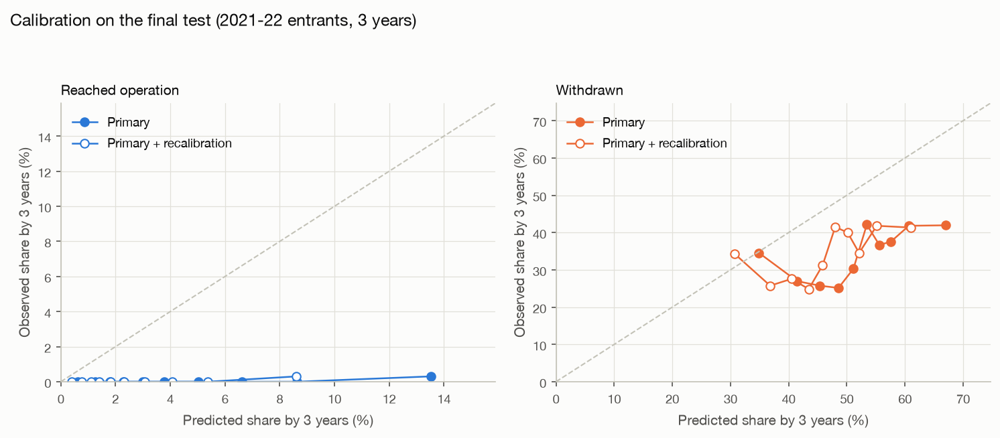
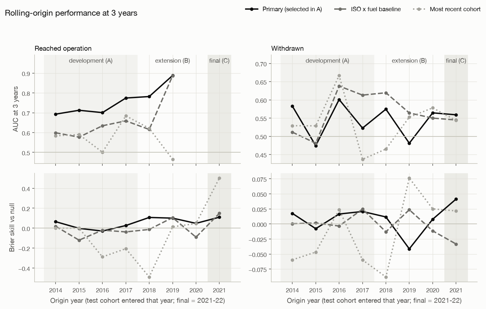

# Evaluation (generated by `make evaluate`, do not edit by hand)

Protocol: [`docs/evaluation_protocol.md`](../docs/evaluation_protocol.md), tag `eval-protocol-v1`
(commit `9e141b7`). The selection was frozen in
[`reports/evaluation_selection.json`](evaluation_selection.json) (commit `7cca0db`)
before blocks B and C were run.

**Primary configuration:** `rsf_cause_specific|qy=0|recal=0` (tie rule: within 0.005 of the best (rsf_cause_specific|qy=0|recal=1, 0.0141) and less complex).
Every other row is a sensitivity analysis, an ablation, or a baseline. None of them can replace
the primary configuration after the fact.

Reading the tables:
- `cases` is the number of projects with that event by 3 years. AUC and C-index are "not
  estimable" below 20 cases.
- `skill` = 1 − IBS / IBS(null), where the null model is one curve with no features. 0 means no
  better than the null.
- Intervals are 95% bootstrap percentile intervals over 1,000 resamples, shown in this order:
  `project`, `county-year`, `ISO-year`.

## Final test (block C, run once): entrants 2021-2022, trained on entrants before 2021-01-01 (outcomes as of that date); 3,299 projects, 0 dropped for follow-up just short of 36 months
### Withdrawn by 3 years
| model | role | n | cases | AUC [CI by unit] | C-index | skill [CI by unit] | Brier@3y | predicted vs observed | ECE |
|---|---|---|---|---|---|---|---|---|---|
| rsf_cause_specific\|qy=0\|recal=0 | PRIMARY | 3299 | 1131 | 0.559 [0.539, 0.579] [0.535, 0.583] | 0.548 (3,041,132 pairs) | 0.041 [0.030, 0.051] [0.023, 0.061] | 0.2570 | 51.6% vs 34.3% | 0.173 |
| recent_cohort | baseline | 3299 | 1131 | 0.544 [0.524, 0.564] [0.517, 0.568] | 0.531 (3,041,132 pairs) | 0.022 [0.009, 0.034] [0.001, 0.042] | 0.2669 | 51.3% vs 34.3% | 0.190 |
| baseline_aj_iso_fuel\|recal=0 | baseline | 3299 | 1131 | 0.545 [0.525, 0.565] [0.519, 0.569] | 0.535 (3,041,132 pairs) | -0.033 [-0.044, -0.023] [-0.052, -0.015] | 0.2808 | 55.0% vs 34.3% | 0.218 |
| baseline_aj_iso_fuel\|recal=1 | baseline | 3299 | 1131 | 0.542 [0.521, 0.562] [0.516, 0.567] | 0.532 (3,041,132 pairs) | 0.078 [0.067, 0.090] [0.059, 0.097] | 0.2583 | 49.0% vs 34.3% | 0.166 |
| cox_cause_specific\|qy=1\|recal=0 | sensitivity | 3299 | 1131 | 0.571 [0.550, 0.592] [0.546, 0.596] | 0.560 (3,041,132 pairs) | 0.173 [0.160, 0.188] [0.154, 0.193] | 0.2326 | 43.6% vs 34.3% | 0.097 |
| cox_cause_specific\|qy=1\|recal=1 | sensitivity | 3299 | 1131 | 0.570 [0.550, 0.591] [0.545, 0.596] | 0.559 (3,041,132 pairs) | 0.216 [0.200, 0.234] [0.193, 0.240] | 0.2266 | 39.7% vs 34.3% | 0.071 |
| cox_cause_specific\|qy=0\|recal=0 | sensitivity | 3299 | 1131 | 0.570 [0.549, 0.589] [0.545, 0.595] | 0.559 (3,041,132 pairs) | 0.110 [0.097, 0.122] [0.092, 0.127] | 0.2443 | 48.3% vs 34.3% | 0.140 |
| cox_cause_specific\|qy=0\|recal=1 | sensitivity | 3299 | 1131 | 0.569 [0.549, 0.589] [0.543, 0.594] | 0.558 (3,041,132 pairs) | 0.186 [0.171, 0.201] [0.164, 0.207] | 0.2315 | 42.7% vs 34.3% | 0.090 |
| lgbm_discrete_time\|qy=1\|recal=0 | sensitivity | 3299 | 1131 | 0.606 [0.585, 0.628] [0.581, 0.632] | 0.579 (3,041,132 pairs) | 0.055 [0.044, 0.065] [0.036, 0.075] | 0.2642 | 55.0% vs 34.3% | 0.209 |
| lgbm_discrete_time\|qy=1\|recal=1 | sensitivity | 3299 | 1131 | 0.607 [0.587, 0.629] [0.581, 0.633] | 0.580 (3,041,132 pairs) | 0.114 [0.101, 0.126] [0.094, 0.134] | 0.2512 | 51.7% vs 34.3% | 0.183 |
| lgbm_discrete_time\|qy=0\|recal=0 | sensitivity | 3299 | 1131 | 0.592 [0.571, 0.613] [0.567, 0.617] | 0.569 (3,041,132 pairs) | 0.076 [0.065, 0.088] [0.059, 0.095] | 0.2561 | 52.8% vs 34.3% | 0.185 |
| lgbm_discrete_time\|qy=0\|recal=1 | sensitivity | 3299 | 1131 | 0.591 [0.571, 0.612] [0.566, 0.616] | 0.568 (3,041,132 pairs) | 0.150 [0.137, 0.164] [0.131, 0.170] | 0.2403 | 47.9% vs 34.3% | 0.138 |
| rsf_cause_specific\|qy=1\|recal=0 | sensitivity | 3299 | 1131 | 0.555 [0.535, 0.576] [0.530, 0.579] | 0.549 (3,041,132 pairs) | 0.127 [0.113, 0.141] [0.105, 0.149] | 0.2376 | 44.1% vs 34.3% | 0.108 |
| rsf_cause_specific\|qy=1\|recal=1 | sensitivity | 3299 | 1131 | 0.554 [0.535, 0.575] [0.530, 0.579] | 0.549 (3,041,132 pairs) | 0.169 [0.154, 0.185] [0.145, 0.192] | 0.2320 | 41.0% vs 34.3% | 0.082 |
| rsf_cause_specific\|qy=0\|recal=1 | sensitivity | 3299 | 1131 | 0.558 [0.538, 0.578] [0.533, 0.582] | 0.548 (3,041,132 pairs) | 0.127 [0.114, 0.141] [0.107, 0.147] | 0.2414 | 46.4% vs 34.3% | 0.128 |
| cox_cause_specific\|no_congestion | ablation (report only) | 3299 | 1131 | 0.579 [0.558, 0.599] [0.553, 0.603] | 0.563 (3,041,132 pairs) | 0.159 [0.147, 0.172] [0.140, 0.177] | 0.2337 | 44.8% vs 34.3% | 0.106 |
| lgbm_discrete_time\|no_congestion | ablation (report only) | 3299 | 1131 | 0.612 [0.592, 0.633] [0.584, 0.637] | 0.580 (3,041,132 pairs) | 0.029 [0.016, 0.042] [0.006, 0.052] | 0.2606 | 54.8% vs 34.3% | 0.208 |
| rsf_cause_specific\|no_congestion | ablation (report only) | 3299 | 1131 | 0.591 [0.570, 0.612] [0.565, 0.614] | 0.575 (3,041,132 pairs) | 0.167 [0.151, 0.182] [0.140, 0.193] | 0.2264 | 41.1% vs 34.3% | 0.112 |

### Operational by 3 years
Only 1 test project(s) reached operation within
3 years, so ranking (AUC, C-index) can't be evaluated. Skill and calibration still can.

| model | role | n | cases | AUC [CI by unit] | C-index | skill [CI by unit] | Brier@3y | predicted vs observed | ECE |
|---|---|---|---|---|---|---|---|---|---|
| rsf_cause_specific\|qy=0\|recal=0 | PRIMARY | 3299 | 1 | not estimable | not estimable | 0.110 [0.045, 0.172] [0.011, 0.196] | 0.0040 | 4.6% vs 0.03% | 0.046 |
| recent_cohort | baseline | 3299 | 1 | not estimable | not estimable | 0.502 [0.389, 0.585] [0.371, 0.595] | 0.0017 | 3.5% vs 0.03% | 0.034 |
| baseline_aj_iso_fuel\|recal=0 | baseline | 3299 | 1 | not estimable | not estimable | 0.149 [0.054, 0.243] [-0.010, 0.280] | 0.0037 | 4.1% vs 0.03% | 0.040 |
| baseline_aj_iso_fuel\|recal=1 | baseline | 3299 | 1 | not estimable | not estimable | 0.656 [0.507, 0.773] [0.488, 0.783] | 0.0014 | 2.2% vs 0.03% | 0.022 |
| cox_cause_specific\|qy=1\|recal=0 | sensitivity | 3299 | 1 | not estimable | not estimable | 0.449 [0.355, 0.532] [0.352, 0.532] | 0.0026 | 4.3% vs 0.03% | 0.043 |
| cox_cause_specific\|qy=1\|recal=1 | sensitivity | 3299 | 1 | not estimable | not estimable | 0.790 [0.627, 0.907] [0.584, 0.907] | 0.0008 | 1.9% vs 0.03% | 0.019 |
| cox_cause_specific\|qy=0\|recal=0 | sensitivity | 3299 | 1 | not estimable | not estimable | 0.370 [0.290, 0.445] [0.287, 0.447] | 0.0029 | 4.6% vs 0.03% | 0.046 |
| cox_cause_specific\|qy=0\|recal=1 | sensitivity | 3299 | 1 | not estimable | not estimable | 0.777 [0.616, 0.893] [0.574, 0.893] | 0.0008 | 2.0% vs 0.03% | 0.020 |
| lgbm_discrete_time\|qy=1\|recal=0 | sensitivity | 3299 | 1 | not estimable | not estimable | 0.025 [-0.080, 0.110] [-0.110, 0.123] | 0.0037 | 5.2% vs 0.03% | 0.052 |
| lgbm_discrete_time\|qy=1\|recal=1 | sensitivity | 3299 | 1 | not estimable | not estimable | 0.682 [0.564, 0.778] [0.539, 0.778] | 0.0011 | 2.6% vs 0.03% | 0.025 |
| lgbm_discrete_time\|qy=0\|recal=0 | sensitivity | 3299 | 1 | not estimable | not estimable | 0.293 [0.196, 0.386] [0.181, 0.388] | 0.0029 | 4.2% vs 0.03% | 0.042 |
| lgbm_discrete_time\|qy=0\|recal=1 | sensitivity | 3299 | 1 | not estimable | not estimable | 0.749 [0.605, 0.865] [0.576, 0.865] | 0.0009 | 2.0% vs 0.03% | 0.019 |
| rsf_cause_specific\|qy=1\|recal=0 | sensitivity | 3299 | 1 | not estimable | not estimable | 0.294 [0.229, 0.371] [0.205, 0.388] | 0.0030 | 3.9% vs 0.03% | 0.038 |
| rsf_cause_specific\|qy=1\|recal=1 | sensitivity | 3299 | 1 | not estimable | not estimable | 0.562 [0.450, 0.659] [0.437, 0.667] | 0.0018 | 2.8% vs 0.03% | 0.028 |
| rsf_cause_specific\|qy=0\|recal=1 | sensitivity | 3299 | 1 | not estimable | not estimable | 0.583 [0.463, 0.680] [0.446, 0.690] | 0.0017 | 2.9% vs 0.03% | 0.029 |
| cox_cause_specific\|no_congestion | ablation (report only) | 3299 | 1 | not estimable | not estimable | 0.361 [0.293, 0.418] [0.286, 0.423] | 0.0031 | 5.0% vs 0.03% | 0.049 |
| lgbm_discrete_time\|no_congestion | ablation (report only) | 3299 | 1 | not estimable | not estimable | 0.184 [0.083, 0.265] [0.065, 0.282] | 0.0032 | 4.5% vs 0.03% | 0.044 |
| rsf_cause_specific\|no_congestion | ablation (report only) | 3299 | 1 | not estimable | not estimable | 0.406 [0.327, 0.492] [0.318, 0.500] | 0.0027 | 3.4% vs 0.03% | 0.033 |

**Rows whose block C skill beats the primary configuration** (they do not replace it, protocol section 8):
- withdrawn (primary 0.041): `baseline_aj_iso_fuel|recal=1` (0.078), `cox_cause_specific|qy=1|recal=0` (0.173), `cox_cause_specific|qy=1|recal=1` (0.216), `cox_cause_specific|qy=0|recal=0` (0.110), `cox_cause_specific|qy=0|recal=1` (0.186), `lgbm_discrete_time|qy=1|recal=0` (0.055), `lgbm_discrete_time|qy=1|recal=1` (0.114), `lgbm_discrete_time|qy=0|recal=0` (0.076), `lgbm_discrete_time|qy=0|recal=1` (0.150), `rsf_cause_specific|qy=1|recal=0` (0.127), `rsf_cause_specific|qy=1|recal=1` (0.169), `rsf_cause_specific|qy=0|recal=1` (0.127), `cox_cause_specific|no_congestion` (0.159), `rsf_cause_specific|no_congestion` (0.167)
- operational (primary 0.110): `recent_cohort` (0.502), `baseline_aj_iso_fuel|recal=0` (0.149), `baseline_aj_iso_fuel|recal=1` (0.656), `cox_cause_specific|qy=1|recal=0` (0.449), `cox_cause_specific|qy=1|recal=1` (0.790), `cox_cause_specific|qy=0|recal=0` (0.370), `cox_cause_specific|qy=0|recal=1` (0.777), `lgbm_discrete_time|qy=1|recal=1` (0.682), `lgbm_discrete_time|qy=0|recal=0` (0.293), `lgbm_discrete_time|qy=0|recal=1` (0.749), `rsf_cause_specific|qy=1|recal=0` (0.294), `rsf_cause_specific|qy=1|recal=1` (0.562), `rsf_cause_specific|qy=0|recal=1` (0.583), `cox_cause_specific|no_congestion` (0.361), `lgbm_discrete_time|no_congestion` (0.184), `rsf_cause_specific|no_congestion` (0.406)

## Development (block A pooled: entrants 2014–2017, each scored by its own origin's models)
### Withdrawn by 3 years
| model | role | n | cases | AUC [CI by unit] | C-index | skill [CI by unit] | Brier@3y | predicted vs observed | ECE |
|---|---|---|---|---|---|---|---|---|---|
| rsf_cause_specific\|qy=0\|recal=0 | PRIMARY | 2843 | 1505 | 0.559 [0.537, 0.581] [0.531, 0.588] [0.500, 0.623] | 0.532 (3,101,760 pairs) | 0.012 [0.004, 0.021] [0.002, 0.024] [-0.001, 0.030] | 0.2594 | 63.4% vs 52.9% | 0.108 |
| recent_cohort | baseline | 2843 | 1505 | 0.532 [0.513, 0.553] [0.507, 0.557] [0.464, 0.595] | 0.520 (3,101,760 pairs) | -0.030 [-0.043, -0.018] [-0.046, -0.015] [-0.100, 0.023] | 0.2645 | 62.0% vs 52.9% | 0.133 |
| baseline_aj_iso_fuel\|recal=0 | baseline | 2843 | 1505 | 0.572 [0.550, 0.591] [0.546, 0.599] [0.491, 0.649] | 0.531 (3,101,760 pairs) | 0.007 [-0.005, 0.019] [-0.008, 0.021] [-0.018, 0.037] | 0.2585 | 63.0% vs 52.9% | 0.109 |
| baseline_aj_iso_fuel\|recal=1 | baseline | 2843 | 1505 | 0.564 [0.544, 0.584] [0.539, 0.591] [0.470, 0.654] | 0.531 (3,101,760 pairs) | 0.001 [-0.012, 0.014] [-0.015, 0.017] [-0.041, 0.055] | 0.2601 | 63.1% vs 52.9% | 0.102 |
| cox_cause_specific\|qy=1\|recal=0 | sensitivity | 2843 | 1505 | 0.566 [0.546, 0.586] [0.539, 0.594] [0.507, 0.633] | 0.545 (3,101,760 pairs) | -0.016 [-0.030, -0.003] [-0.034, 0.003] [-0.053, 0.022] | 0.2623 | 63.0% vs 52.9% | 0.125 |
| cox_cause_specific\|qy=1\|recal=1 | sensitivity | 2843 | 1505 | 0.568 [0.548, 0.589] [0.541, 0.596] [0.506, 0.644] | 0.546 (3,101,760 pairs) | -0.026 [-0.040, -0.011] [-0.044, -0.006] [-0.078, 0.025] | 0.2643 | 63.6% vs 52.9% | 0.129 |
| cox_cause_specific\|qy=0\|recal=0 | sensitivity | 2843 | 1505 | 0.551 [0.531, 0.572] [0.522, 0.580] [0.494, 0.615] | 0.533 (3,101,760 pairs) | -0.012 [-0.026, 0.002] [-0.030, 0.006] [-0.040, 0.018] | 0.2621 | 61.6% vs 52.9% | 0.125 |
| cox_cause_specific\|qy=0\|recal=1 | sensitivity | 2843 | 1505 | 0.554 [0.534, 0.576] [0.526, 0.583] [0.493, 0.629] | 0.535 (3,101,760 pairs) | -0.018 [-0.031, -0.003] [-0.035, 0.001] [-0.055, 0.022] | 0.2629 | 62.0% vs 52.9% | 0.115 |
| lgbm_discrete_time\|qy=1\|recal=0 | sensitivity | 2843 | 1505 | 0.576 [0.556, 0.598] [0.549, 0.605] [0.511, 0.651] | 0.548 (3,101,760 pairs) | 0.007 [-0.002, 0.016] [-0.005, 0.019] [-0.024, 0.034] | 0.2634 | 65.7% vs 52.9% | 0.128 |
| lgbm_discrete_time\|qy=1\|recal=1 | sensitivity | 2843 | 1505 | 0.574 [0.554, 0.594] [0.548, 0.599] [0.501, 0.660] | 0.547 (3,101,760 pairs) | 0.016 [0.005, 0.026] [0.002, 0.030] [-0.027, 0.064] | 0.2579 | 63.2% vs 52.9% | 0.103 |
| lgbm_discrete_time\|qy=0\|recal=0 | sensitivity | 2843 | 1505 | 0.559 [0.539, 0.580] [0.532, 0.586] [0.499, 0.630] | 0.532 (3,101,760 pairs) | -0.001 [-0.012, 0.009] [-0.015, 0.012] [-0.024, 0.022] | 0.2662 | 65.9% vs 52.9% | 0.137 |
| lgbm_discrete_time\|qy=0\|recal=1 | sensitivity | 2843 | 1505 | 0.564 [0.545, 0.585] [0.537, 0.589] [0.492, 0.648] | 0.536 (3,101,760 pairs) | 0.009 [-0.003, 0.021] [-0.006, 0.024] [-0.028, 0.054] | 0.2602 | 63.4% vs 52.9% | 0.109 |
| rsf_cause_specific\|qy=1\|recal=0 | sensitivity | 2843 | 1505 | 0.574 [0.554, 0.596] [0.547, 0.601] [0.509, 0.650] | 0.550 (3,101,760 pairs) | 0.034 [0.023, 0.044] [0.022, 0.048] [0.009, 0.068] | 0.2491 | 57.8% vs 52.9% | 0.065 |
| rsf_cause_specific\|qy=1\|recal=1 | sensitivity | 2843 | 1505 | 0.574 [0.554, 0.597] [0.548, 0.600] [0.505, 0.659] | 0.550 (3,101,760 pairs) | 0.037 [0.025, 0.049] [0.023, 0.053] [0.004, 0.087] | 0.2482 | 55.9% vs 52.9% | 0.054 |
| rsf_cause_specific\|qy=0\|recal=1 | sensitivity | 2843 | 1505 | 0.563 [0.544, 0.585] [0.537, 0.591] [0.499, 0.640] | 0.537 (3,101,760 pairs) | 0.023 [0.013, 0.032] [0.012, 0.035] [-0.002, 0.052] | 0.2552 | 61.6% vs 52.9% | 0.099 |
| cox_cause_specific\|no_congestion | ablation (report only) | 2843 | 1505 | 0.573 [0.553, 0.594] [0.547, 0.603] [0.512, 0.643] | 0.550 (3,101,760 pairs) | -0.009 [-0.023, 0.004] [-0.026, 0.010] [-0.048, 0.029] | 0.2600 | 63.2% vs 52.9% | 0.123 |
| lgbm_discrete_time\|no_congestion | ablation (report only) | 2843 | 1505 | 0.588 [0.568, 0.608] [0.561, 0.617] [0.522, 0.658] | 0.558 (3,101,760 pairs) | 0.018 [0.009, 0.028] [0.007, 0.031] [-0.007, 0.043] | 0.2597 | 65.2% vs 52.9% | 0.122 |
| rsf_cause_specific\|no_congestion | ablation (report only) | 2843 | 1505 | 0.599 [0.579, 0.621] [0.572, 0.627] [0.529, 0.678] | 0.569 (3,101,760 pairs) | 0.051 [0.037, 0.065] [0.034, 0.069] [0.014, 0.107] | 0.2426 | 53.7% vs 52.9% | 0.049 |

### Operational by 3 years
| model | role | n | cases | AUC [CI by unit] | C-index | skill [CI by unit] | Brier@3y | predicted vs observed | ECE |
|---|---|---|---|---|---|---|---|---|---|
| rsf_cause_specific\|qy=0\|recal=0 | PRIMARY | 2843 | 178 | 0.723 [0.689, 0.760] [0.680, 0.763] [0.654, 0.785] | 0.718 (489,609 pairs) | 0.020 [-0.007, 0.043] [-0.010, 0.045] [-0.017, 0.055] | 0.0587 | 10.7% vs 6.3% | 0.044 |
| recent_cohort | baseline | 2843 | 178 | 0.472 [0.436, 0.511] [0.426, 0.520] [0.375, 0.611] | 0.474 (489,609 pairs) | -0.107 [-0.139, -0.082] [-0.149, -0.076] [-0.262, -0.016] | 0.0718 | 13.3% vs 6.3% | 0.099 |
| baseline_aj_iso_fuel\|recal=0 | baseline | 2843 | 178 | 0.598 [0.556, 0.639] [0.552, 0.643] [0.509, 0.673] | 0.596 (489,609 pairs) | -0.033 [-0.061, -0.008] [-0.067, -0.006] [-0.103, 0.014] | 0.0623 | 9.8% vs 6.3% | 0.053 |
| baseline_aj_iso_fuel\|recal=1 | baseline | 2843 | 178 | 0.578 [0.539, 0.617] [0.533, 0.623] [0.473, 0.660] | 0.577 (489,609 pairs) | -0.046 [-0.076, -0.020] [-0.080, -0.017] [-0.132, 0.005] | 0.0635 | 10.3% vs 6.3% | 0.060 |
| cox_cause_specific\|qy=1\|recal=0 | sensitivity | 2843 | 178 | 0.693 [0.653, 0.733] [0.647, 0.739] [0.605, 0.770] | 0.689 (489,609 pairs) | 0.009 [-0.017, 0.031] [-0.020, 0.033] [-0.041, 0.042] | 0.0598 | 10.6% vs 6.3% | 0.044 |
| cox_cause_specific\|qy=1\|recal=1 | sensitivity | 2843 | 178 | 0.638 [0.596, 0.682] [0.590, 0.684] [0.543, 0.737] | 0.636 (489,609 pairs) | -0.024 [-0.055, 0.003] [-0.057, 0.007] [-0.098, 0.023] | 0.0626 | 11.6% vs 6.3% | 0.056 |
| cox_cause_specific\|qy=0\|recal=0 | sensitivity | 2843 | 178 | 0.724 [0.687, 0.760] [0.680, 0.767] [0.639, 0.796] | 0.719 (489,609 pairs) | 0.027 [0.005, 0.047] [0.004, 0.047] [-0.010, 0.055] | 0.0581 | 9.4% vs 6.3% | 0.032 |
| cox_cause_specific\|qy=0\|recal=1 | sensitivity | 2843 | 178 | 0.670 [0.629, 0.711] [0.623, 0.715] [0.578, 0.760] | 0.667 (489,609 pairs) | 0.003 [-0.021, 0.024] [-0.024, 0.026] [-0.045, 0.036] | 0.0602 | 10.4% vs 6.3% | 0.043 |
| lgbm_discrete_time\|qy=1\|recal=0 | sensitivity | 2843 | 178 | 0.648 [0.602, 0.693] [0.597, 0.694] [0.567, 0.727] | 0.646 (489,609 pairs) | 0.004 [-0.016, 0.023] [-0.018, 0.024] [-0.026, 0.031] | 0.0596 | 10.3% vs 6.3% | 0.043 |
| lgbm_discrete_time\|qy=1\|recal=1 | sensitivity | 2843 | 178 | 0.599 [0.553, 0.646] [0.548, 0.647] [0.518, 0.690] | 0.599 (489,609 pairs) | -0.024 [-0.048, -0.003] [-0.053, -0.000] [-0.083, 0.016] | 0.0619 | 11.2% vs 6.3% | 0.052 |
| lgbm_discrete_time\|qy=0\|recal=0 | sensitivity | 2843 | 178 | 0.685 [0.644, 0.725] [0.638, 0.730] [0.610, 0.763] | 0.681 (489,609 pairs) | 0.001 [-0.025, 0.026] [-0.031, 0.029] [-0.058, 0.045] | 0.0598 | 9.6% vs 6.3% | 0.043 |
| lgbm_discrete_time\|qy=0\|recal=1 | sensitivity | 2843 | 178 | 0.639 [0.598, 0.679] [0.594, 0.686] [0.557, 0.729] | 0.637 (489,609 pairs) | -0.021 [-0.049, 0.004] [-0.056, 0.008] [-0.088, 0.033] | 0.0615 | 10.2% vs 6.3% | 0.042 |
| rsf_cause_specific\|qy=1\|recal=0 | sensitivity | 2843 | 178 | 0.686 [0.648, 0.727] [0.641, 0.727] [0.610, 0.758] | 0.683 (489,609 pairs) | -0.011 [-0.042, 0.016] [-0.047, 0.020] [-0.072, 0.041] | 0.0612 | 12.3% vs 6.3% | 0.060 |
| rsf_cause_specific\|qy=1\|recal=1 | sensitivity | 2843 | 178 | 0.673 [0.634, 0.714] [0.625, 0.715] [0.596, 0.747] | 0.670 (489,609 pairs) | -0.011 [-0.040, 0.015] [-0.046, 0.018] [-0.072, 0.040] | 0.0615 | 12.1% vs 6.3% | 0.059 |
| rsf_cause_specific\|qy=0\|recal=1 | sensitivity | 2843 | 178 | 0.708 [0.673, 0.745] [0.664, 0.750] [0.635, 0.774] | 0.704 (489,609 pairs) | 0.014 [-0.012, 0.038] [-0.017, 0.039] [-0.027, 0.052] | 0.0593 | 10.7% vs 6.3% | 0.045 |
| cox_cause_specific\|no_congestion | ablation (report only) | 2843 | 178 | 0.649 [0.606, 0.694] [0.600, 0.695] [0.548, 0.747] | 0.647 (489,609 pairs) | 0.015 [-0.006, 0.034] [-0.009, 0.036] [-0.026, 0.043] | 0.0598 | 10.5% vs 6.3% | 0.044 |
| lgbm_discrete_time\|no_congestion | ablation (report only) | 2843 | 178 | 0.661 [0.617, 0.707] [0.612, 0.707] [0.568, 0.747] | 0.659 (489,609 pairs) | 0.011 [-0.010, 0.030] [-0.014, 0.031] [-0.019, 0.039] | 0.0591 | 10.7% vs 6.3% | 0.049 |
| rsf_cause_specific\|no_congestion | ablation (report only) | 2843 | 178 | 0.626 [0.586, 0.667] [0.580, 0.668] [0.540, 0.720] | 0.624 (489,609 pairs) | -0.039 [-0.077, -0.008] [-0.086, -0.003] [-0.135, 0.029] | 0.0643 | 12.3% vs 6.3% | 0.061 |

The ISO-year intervals rest on only 16 groups and are labelled unreliable (protocol section 5).

## Rolling-origin view (blocks A, B, C at 3 years)

Skill at 3 years, by origin:

| outcome | model | 2014 | 2015 | 2016 | 2017 | 2018 | 2019 | 2020 | 2021 |
|---|---|---|---|---|---|---|---|---|---|
| operational | baseline_aj_iso_fuel\|recal=0 | 0.018 | -0.121 | -0.02 | -0.038 | -0.013 | 0.106 | -0.091 | 0.149 |
| operational | null_aj | 0.0 | 0.0 | 0.0 | 0.0 | 0.0 | 0.0 | 0.0 | 0.0 |
| operational | recent_cohort | 0.0 | -0.0 | -0.289 | -0.206 | -0.49 | 0.013 | 0.046 | 0.502 |
| operational | rsf_cause_specific\|qy=0\|recal=0 | 0.065 | -0.002 | -0.029 | 0.026 | 0.107 | 0.1 | 0.048 | 0.11 |
| withdrawn | baseline_aj_iso_fuel\|recal=0 | 0.0 | 0.002 | -0.003 | 0.025 | -0.013 | 0.024 | -0.011 | -0.033 |
| withdrawn | null_aj | 0.0 | 0.0 | 0.0 | 0.0 | 0.0 | 0.0 | 0.0 | 0.0 |
| withdrawn | recent_cohort | -0.06 | -0.047 | 0.024 | -0.06 | -0.088 | 0.076 | 0.025 | 0.022 |
| withdrawn | rsf_cause_specific\|qy=0\|recal=0 | 0.018 | -0.008 | 0.016 | 0.021 | 0.012 | -0.041 | 0.008 | 0.041 |

AUC at 3 years, by origin:

| outcome | model | 2014 | 2015 | 2016 | 2017 | 2018 | 2019 | 2020 | 2021 |
|---|---|---|---|---|---|---|---|---|---|
| operational | baseline_aj_iso_fuel\|recal=0 | 0.599 | 0.577 | 0.634 | 0.659 | 0.616 | 0.887 |  |  |
| operational | null_aj | 0.5 | 0.5 | 0.5 | 0.5 | 0.5 | 0.5 |  |  |
| operational | recent_cohort | 0.584 | 0.59 | 0.501 | 0.684 | 0.622 | 0.465 |  |  |
| operational | rsf_cause_specific\|qy=0\|recal=0 | 0.693 | 0.712 | 0.701 | 0.774 | 0.782 | 0.888 |  |  |
| withdrawn | baseline_aj_iso_fuel\|recal=0 | 0.511 | 0.481 | 0.638 | 0.613 | 0.62 | 0.564 | 0.55 | 0.545 |
| withdrawn | null_aj | 0.5 | 0.5 | 0.5 | 0.5 | 0.5 | 0.5 | 0.5 | 0.5 |
| withdrawn | recent_cohort | 0.529 | 0.529 | 0.667 | 0.437 | 0.465 | 0.553 | 0.578 | 0.544 |
| withdrawn | rsf_cause_specific\|qy=0\|recal=0 | 0.583 | 0.474 | 0.601 | 0.523 | 0.574 | 0.481 | 0.564 | 0.559 |

Cases at 3 years, by origin:

| outcome | 2014 | 2015 | 2016 | 2017 | 2018 | 2019 | 2020 | 2021 |
|---|---|---|---|---|---|---|---|---|
| operational | 65 | 44 | 44 | 25 | 24 | 31 | 14 | 1 |
| withdrawn | 272 | 337 | 508 | 388 | 456 | 469 | 544 | 1131 |

Skill at 5 years (report only; origins with 5 years of follow-up), with case counts:

| outcome | model | 2014 | 2015 | 2018 | 2019 | 2020 |
|---|---|---|---|---|---|---|
| operational | baseline_aj_iso_fuel\|recal=0 | 0.03 | -0.125 | 0.003 | 0.154 | 0.047 |
| operational | null_aj | 0.0 | 0.0 | 0.0 | 0.0 | 0.0 |
| operational | recent_cohort |  |  | -0.681 | -0.782 | -1.255 |
| operational | rsf_cause_specific\|qy=0\|recal=0 | 0.077 | 0.01 | 0.126 | 0.135 | 0.115 |
| withdrawn | baseline_aj_iso_fuel\|recal=0 | -0.006 | -0.019 | -0.026 | -0.026 | -0.011 |
| withdrawn | null_aj | 0.0 | 0.0 | 0.0 | 0.0 | 0.0 |
| withdrawn | recent_cohort |  |  | 0.002 | 0.056 | 0.001 |
| withdrawn | rsf_cause_specific\|qy=0\|recal=0 | 0.021 | -0.014 | 0.001 | -0.068 | 0.01 |

| outcome | 2014 | 2015 | 2018 | 2019 | 2020 |
|---|---|---|---|---|---|
| operational | 99 | 104 | 43 | 70 | 32 |
| withdrawn | 303 | 410 | 560 | 621 | 984 |

Spread of the primary configuration across the seven origins in blocks A and B (the measure of
era-to-era uncertainty):

| outcome | auc mean | auc std | auc min | auc max | skill mean | skill std | skill min | skill max |
|---|---|---|---|---|---|---|---|---|
| operational | 0.758 | 0.074 | 0.693 | 0.888 | 0.045 | 0.051 | -0.029 | 0.107 |
| withdrawn | 0.543 | 0.051 | 0.474 | 0.601 | 0.004 | 0.022 | -0.041 | 0.021 |

## Congestion features: ablation (report only)
Each family with all features vs without the congestion features (`queue_year` kept and no
recalibration in both). AUC is blank where there are fewer than 20 cases.

| family | block | outcome | cases | skill with | skill without | AUC with | AUC without |
|---|---|---|---|---|---|---|---|
| cox_cause_specific | A-pooled | withdrawn | 1505 | -0.016 | -0.009 | 0.566 | 0.573 |
| cox_cause_specific | A-pooled | operational | 178 | 0.009 | 0.015 | 0.693 | 0.649 |
| cox_cause_specific | C | withdrawn | 1131 | 0.173 | 0.159 | 0.571 | 0.579 |
| cox_cause_specific | C | operational | 1 | 0.449 | 0.361 |  |  |
| lgbm_discrete_time | A-pooled | withdrawn | 1505 | 0.007 | 0.018 | 0.576 | 0.588 |
| lgbm_discrete_time | A-pooled | operational | 178 | 0.004 | 0.011 | 0.648 | 0.661 |
| lgbm_discrete_time | C | withdrawn | 1131 | 0.055 | 0.029 | 0.606 | 0.612 |
| lgbm_discrete_time | C | operational | 1 | 0.025 | 0.184 |  |  |
| rsf_cause_specific | A-pooled | withdrawn | 1505 | 0.034 | 0.051 | 0.574 | 0.599 |
| rsf_cause_specific | A-pooled | operational | 178 | -0.011 | -0.039 | 0.686 | 0.626 |
| rsf_cause_specific | C | withdrawn | 1131 | 0.127 | 0.167 | 0.555 | 0.591 |
| rsf_cause_specific | C | operational | 1 | 0.294 | 0.406 |  |  |

## Bootstrap units
Median width of grouped intervals relative to project intervals (1.0 = same width):

| block | ISO-year | county-year |
|---|---|---|
| A-pooled | 3.01 | 1.23 |
| C |  | 1.27 |

## Recalibration constants for the primary family
Hazard multipliers fitted at each origin on the reference cohort Y−4 (protocol section 7).
Values below 1 mean the model's hazards were too high for the most recent fully observed cohort.

| origin | c_operational | c_withdrawn |
|---|---|---|
| A-2014 | 0.884 | 0.904 |
| A-2015 | 0.921 | 1.036 |
| A-2016 | 1.075 | 1.014 |
| A-2017 | 0.958 | 0.85 |
| B-2018 | 1.264 | 1.004 |
| B-2019 | 0.685 | 0.907 |
| B-2020 | 0.741 | 0.957 |
| C-2021 | 0.56 | 0.85 |

## Block B notes
Block B (origins 2018–2020) was seen in Phase 4 and is reported only, never used for decisions.
Rows: 228 metric rows in `reports/evaluation_metrics.csv`. Every point metric with its
counts is in that file. Every bootstrap interval, including paired differences against the
primary configuration (`*_minus_primary`), is in `reports/evaluation_bootstrap.csv`.

## Data check: missing withdrawal dates and the final-test gap (added after the final run)
A post-hoc data check, added after block C was run. It re-scores nothing.

Withdrawn projects with no withdrawal date were excluded from model scope (rule
`missing_event_date`). Each exclusion removes a withdrawal from its entry cohort and lowers the
observed withdrawal rate. Withdrawn projects that pass every other scope rule, by entry year:

| entry_year | withdrawn_projects | missing_withdrawal_date | missing_% |
|---|---|---|---|
| 2010 | 651 | 27 | 4.1 |
| 2011 | 571 | 9 | 1.6 |
| 2012 | 216 | 5 | 2.3 |
| 2013 | 197 | 2 | 1.0 |
| 2014 | 321 | 3 | 0.9 |
| 2015 | 443 | 2 | 0.5 |
| 2016 | 641 | 13 | 2.0 |
| 2017 | 584 | 3 | 0.5 |
| 2018 | 625 | 2 | 0.3 |
| 2019 | 714 | 2 | 0.3 |
| 2020 | 1077 | 29 | 2.7 |
| 2021 | 1369 | 17 | 1.2 |
| 2022 | 829 | 6 | 0.7 |
| 2023 | 832 | 6 | 0.7 |
| 2024 | 439 | 14 | 3.2 |
| 2025 | 321 | 17 | 5.3 |

For the final-test cohorts (2021-2022),
23 undated withdrawals were excluded
(2021: 1.2%, 2022: 0.7% of withdrawn projects).

**Upper bound on the effect.** Suppose every one of them were put back into the test cohort and
had withdrawn within 3 years. The observed 3-year withdrawal rate would rise from
34.3% to at most 34.7%, against 51.6%
predicted. That closes at most 3% of the
17.3-point gap. **Missing dates can explain only a small part of the
overprediction. Most of it is the model expecting more withdrawals than the 2021–22 entrants
showed.**

One measurement issue can't be checked from a single snapshot: withdrawals that happened but
weren't yet recorded by the data date (status still "active"). That would also lower the observed
rate for recent cohorts. Comparing with the next LBNL edition is the way to test it.
