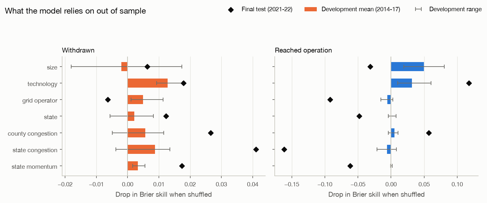
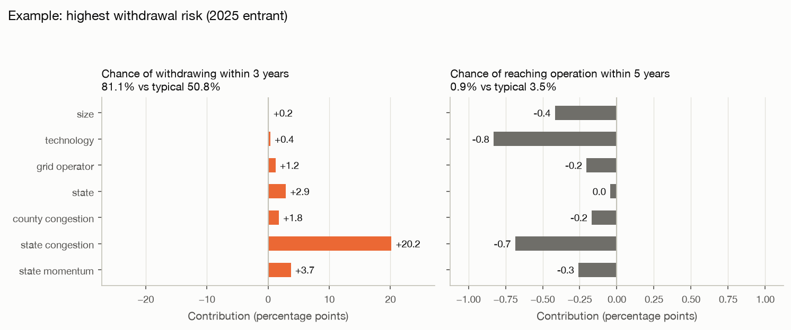

# Explanations (generated by `make explain`, do not edit by hand)

Model explained: the **primary configuration** `rsf_cause_specific|qy=0|recal=0` frozen in Phase 5, refit on all
in-scope data as the **deployment model** (14,796 projects, outcomes as of
2025-12-31; fit in 15.0 s). Decisions D-039 to D-042.

Explanations describe **what the model relies on**, not what causes withdrawal or completion.

## 1. Reproducibility check
The primary configuration was refit at each Phase 5 origin. Its test predictions match the
saved Phase 5 predictions:

| block | origin | test_projects | max_abs_difference_vs_phase5 |
|---|---|---|---|
| A | 2014 | 447 | 3.0e-08 |
| A | 2015 | 631 | 3.0e-08 |
| A | 2016 | 901 | 3.0e-08 |
| A | 2017 | 864 | 3.0e-08 |
| C | 2021 | 3299 | 3.0e-08 |

## 2. What the model relies on out of sample (grouped permutation importance)
Each group's columns are shuffled together across the test cohort (5 repeats), and
the drop in performance is measured: Brier skill vs the null model, and AUC (3 years). Higher means
the model relies more on that group. Values near 0 (or below 0) mean the group adds nothing out of
sample. Block A = the four development origins (mean, min, max). Block C = the final test (2021–22
entrants), where operational AUC is not estimable (1 case). Report only.

### Withdrawn
| group | skill drop: development mean [range] | skill drop: final test | auc drop: development mean [range] | auc drop: final test |
|---|---|---|---|---|
| size | -0.0020 [-0.0180, +0.0173] | +0.0063 | -0.0006 [-0.0371, +0.0536] | +0.0091 |
| technology | +0.0128 [+0.0093, +0.0176] | +0.0178 | +0.0211 [+0.0058, +0.0432] | +0.0026 |
| grid operator | +0.0050 [+0.0011, +0.0113] | -0.0063 | +0.0148 [-0.0011, +0.0338] | -0.0132 |
| state | +0.0021 [-0.0057, +0.0082] | +0.0123 | +0.0042 [-0.0089, +0.0193] | +0.0419 |
| county congestion | +0.0056 [-0.0050, +0.0116] | +0.0265 | -0.0003 [-0.0197, +0.0107] | -0.0058 |
| state congestion | +0.0088 [-0.0037, +0.0135] | +0.0411 | +0.0012 [-0.0150, +0.0159] | +0.0259 |
| state momentum | +0.0032 [+0.0016, +0.0055] | +0.0174 | +0.0046 [+0.0009, +0.0086] | +0.0023 |

### Operational
| group | skill drop: development mean [range] | skill drop: final test | auc drop: development mean [range] | auc drop: final test |
|---|---|---|---|---|
| size | +0.0495 [+0.0192, +0.0804] | -0.0316 | +0.1079 [+0.0474, +0.1653] | not estimable |
| technology | +0.0318 [+0.0100, +0.0602] | +0.1176 | +0.0989 [+0.0328, +0.1863] | not estimable |
| grid operator | -0.0054 [-0.0152, +0.0029] | -0.0922 | -0.0128 [-0.0491, +0.0256] | not estimable |
| state | +0.0005 [-0.0043, +0.0074] | -0.0482 | +0.0022 [-0.0047, +0.0191] | not estimable |
| county congestion | +0.0053 [-0.0042, +0.0104] | +0.0568 | +0.0201 [+0.0020, +0.0411] | not estimable |
| state congestion | -0.0062 [-0.0214, +0.0081] | -0.1615 | +0.0143 [-0.0206, +0.0520] | not estimable |
| state momentum | +0.0005 [-0.0007, +0.0016] | -0.0617 | +0.0032 [-0.0005, +0.0088] | not estimable |

## 3. What moves individual predictions (deployment model, mean |Shapley|)
Exact grouped Shapley values (all 128 group combinations) for 100 randomly chosen 2025
entrants. The comparison point is the average prediction over 64 random
2021–2025 entrants (a "typical recent project").
Values are the mean absolute contribution in percentage points. For every explained project, the
contributions add up to the prediction minus the baseline, with a largest gap of 5.6e-17.

| group | Chance of withdrawing within 3 years | Chance of reaching operation within 5 years |
|---|---|---|
| size | 0.45 | 0.82 |
| technology | 1.06 | 2.18 |
| grid operator | 2.01 | 0.64 |
| state | 2.97 | 0.45 |
| county congestion | 1.06 | 0.31 |
| state congestion | 4.63 | 1.24 |
| state momentum | 3.26 | 0.51 |

Permutation importance (section 2) asks "does the model *need* this group to predict well on new
cohorts?" Shapley values (section 3) ask "how much does this group *move* the prediction?" A group
can move predictions a lot without improving accuracy. Where the two disagree, trust section 2 for
accuracy and section 3 for what the model is doing.

## 4. Example explanations (2025 entrants, still in the queue)
These are what the dashboard will show. Points are percentage points relative to the typical recent
project.

### highest withdrawal risk: `MISO::J4104`

- Chance of withdrawing within 3 years: 81.1% (typical recent project: 50.8%). Pushing it up: state congestion (+20.2 points: 2158 earlier requests in the state in 5 years, 14% already withdrawn); state momentum (+3.7 points: 482 requests in the state in the past year); state (+2.9 points: TX).
- Chance of reaching operation within 5 years: 0.9% (typical recent project: 3.5%). Pulling it down: technology (-0.8 points: battery); state congestion (-0.7 points: 2158 earlier requests in the state in 5 years, 14% already withdrawn).

| group | Chance of withdrawing within 3 years (points) | Chance of reaching operation within 5 years (points) |
|---|---|---|
| size | 0.16 | -0.42 |
| technology | 0.36 | -0.83 |
| grid operator | 1.21 | -0.2 |
| state | 2.9 | -0.04 |
| county congestion | 1.76 | -0.17 |
| state congestion | 20.16 | -0.69 |
| state momentum | 3.72 | -0.26 |

### median: `SPP::GEN-2024-275`

- Chance of withdrawing within 3 years: 54.8% (typical recent project: 50.8%). Pushing it up: state congestion (+1.6 points: 168 earlier requests in the state in 5 years, 21% already withdrawn); grid operator (+1.2 points: SPP); state (+0.9 points: MO).
- Chance of reaching operation within 5 years: 1.0% (typical recent project: 3.5%). Pulling it down: state congestion (-0.9 points: 168 earlier requests in the state in 5 years, 21% already withdrawn); size (-0.6 points: 150 MW).

| group | Chance of withdrawing within 3 years (points) | Chance of reaching operation within 5 years (points) |
|---|---|---|
| size | -0.3 | -0.59 |
| technology | 0.2 | -0.05 |
| grid operator | 1.17 | -0.35 |
| state | 0.94 | -0.25 |
| county congestion | 0.36 | -0.23 |
| state congestion | 1.6 | -0.85 |
| state momentum | 0.01 | -0.2 |

### lowest withdrawal risk: `PJM::AG2-675`

- Chance of withdrawing within 3 years: 24.2% (typical recent project: 50.8%). Pulling it down: state (-7.7 points: IL); state momentum (-6.7 points: 149 requests in the state in the past year); state congestion (-5.1 points: 537 earlier requests in the state in 5 years, 21% already withdrawn).
- Chance of reaching operation within 5 years: 1.9% (typical recent project: 3.5%). Pushing it up: state (+0.6 points: IL). Pulling it down: state congestion (-1.0 points: 537 earlier requests in the state in 5 years, 21% already withdrawn); technology (-0.5 points: battery).

| group | Chance of withdrawing within 3 years (points) | Chance of reaching operation within 5 years (points) |
|---|---|---|
| size | -0.8 | -0.47 |
| technology | -0.47 | -0.51 |
| grid operator | -4.09 | 0.36 |
| state | -7.68 | 0.63 |
| county congestion | -1.75 | -0.18 |
| state congestion | -5.11 | -1.04 |
| state momentum | -6.7 | -0.43 |

## 5. Cox hazard ratios (interpretable reference, not the deployed model)
A cause-specific Cox model with the same features, fit on the same data. Hazard ratios are per one
standard deviation of the (log-transformed for counts and MW) feature, or against the reference
category. These are the 12 covariates with the largest effect on either outcome. Caveats: the
features are correlated and ridge-penalised, proportional hazards is only approximate (D-029), and
none of this is causal.

| covariate | operational | withdrawn |
|---|---|---|
| fuel_group=gas | 2.33 | 1.012 |
| state=DE | 0.48 | 1.336 |
| state=WV | 0.608 | 0.911 |
| fuel_group=other | 1.643 | 0.904 |
| county_known | 1.131 | 0.613 |
| state=other | 0.627 | 0.961 |
| state=NJ | 1.536 | 1.302 |
| state=KY | 0.672 | 0.929 |
| state_prior_requests_5y_missing | 1.234 | 0.679 |
| state=IL | 0.929 | 0.708 |
| state=WI | 0.822 | 0.711 |
| state=NM | 1.056 | 1.396 |
